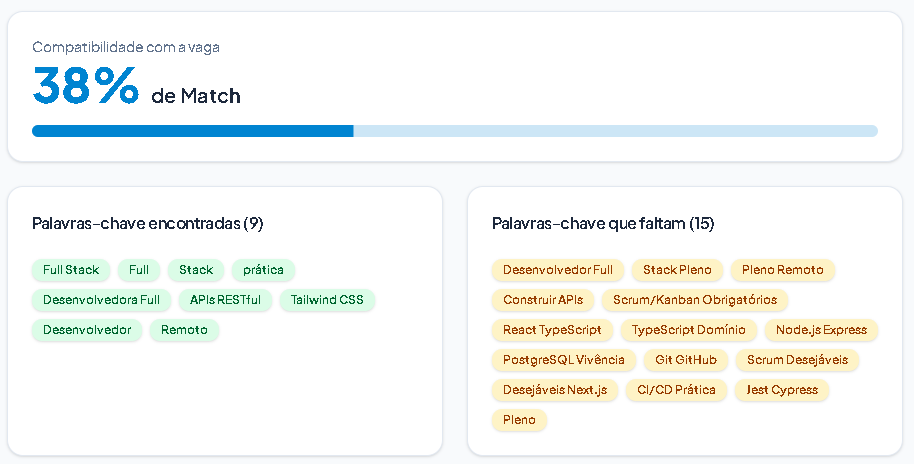
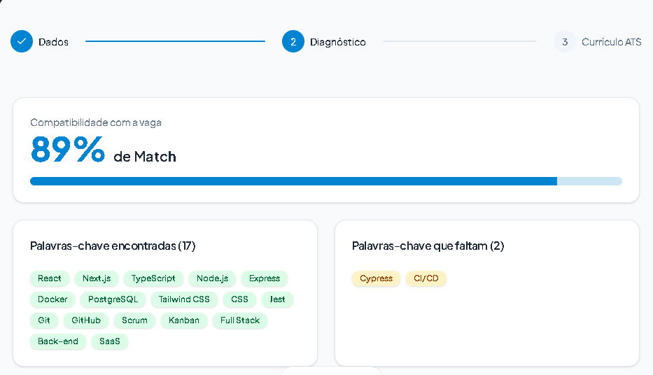
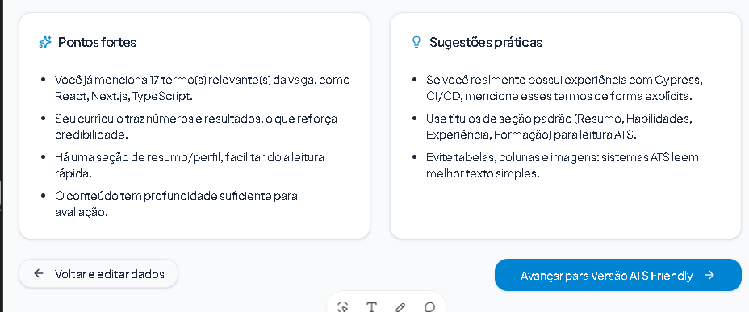

# 📄 Otimizador de Currículos ATS Friendly

> Aplicação web desenvolvida no **Lovable** para matchmaking inteligente entre currículos e descrições de vagas, gerando versões otimizadas para sistemas ATS (Applicant Tracking Systems) sem ferir a integridade profissional do candidato.

🌐 **Aplicação no ar:** https://lite-ats-matchmaker.lovable.app/

---

## 🎯 Qual problema a aplicação resolve?

Milhares de profissionais qualificados são desclassificados em processos seletivos antes mesmo de um recrutador humano ler seu perfil. Isso acontece por conta dos sistemas **ATS** (*Applicant Tracking Systems*), que utilizam robôs para ler e ranquear currículos a partir de palavras-chave extraídas da vaga.

O problema é que muitas vezes o candidato domina as competências exigidas, mas utiliza sinônimos ou formatações que os robôs não interpretam bem. 

A aplicação resolve isso em segundos:
1. Analisa a aderência entre a vaga e a experiência real da pessoa;
2. Aponta exatamente quais termos técnicos constam e quais faltam;
3. Gera uma versão limpa, legível e otimizada para sistemas ATS.

> ⚖️ **Compromisso Ético:** A ferramenta ajuda o candidato a se apresentar da melhor forma possível, mas **nunca inventa experiências ou competências que ele não possui**.

---

## 🔍 Evidência de Funcionamento e Evolução (Antes vs. Depois)

Durante a criação no Lovable, a aplicação foi submetida a testes com currículos e vagas reais. Esse processo de validação permitiu refinar o algoritmo de extração de palavras-chave:

### 1. Primeira Geração (Problema Detectado)
No primeiro teste com uma candidata fictícia altamente qualificada para a vaga (Mariana Castro), o sistema marcou apenas **38% de compatibilidade**. 
O teste revelou que o algoritmo estava juntando palavras separadas por ponto final e títulos de seções, criando termos inexistentes como `TypeScript Domínio` e `PostgreSQL Vivência`:

---

### 2. Versão Refinada (Diagnóstico Preciso)
Após um ajuste no prompt orientando o Lovable a tokenizar tecnologias de forma individual e ignorar quebras de linha e títulos, o resultado foi imediato:
- **89% de Match Real**;
- **17 palavras-chave técnicas encontradas com precisão**;
- **Apenas 2 termos faltantes identificados** (`Cypress` e `CI/CD`, que realmente não constavam no perfil testado).

---

### 3. Insights e Recomendações Éticas
Além da pontuação, a aplicação gera diagnósticos acionáveis, reforçando sempre a integridade das informações:

---

## 🚀 Como a aplicação funciona

O fluxo é dividido em um assistente (*Wizard*) de 3 passos simples, sem necessidade de login ou cadastro:

1. **Entrada de Dados:** A pessoa insere a descrição completa da vaga (com link opcional) e o texto do seu currículo atual.
2. **Diagnóstico & Matchmaking ATS:** O sistema calcula a porcentagem de compatibilidade, destaca as palavras-chave encontradas e ausentes e fornece dicas práticas de melhoria.
3. **Currículo Otimizado & Exportação:** A aplicação reorganiza o currículo em um padrão textual limpo para ATS, destacando o cargo desejado no resumo, e oferece botões para copiar o texto ou imprimir/exportar em PDF.

---

## 🤖 Engenharia de Prompt e Refinamentos

### Mega Prompt Utilizado
A aplicação foi concebida a partir de um prompt único em Markdown contendo:
- Diretrizes de escopo para caber no limite gratuito de créditos do Lovable;
- Design System oficial do **shadcn/ui** com paleta de cores calmas (branco, slate e toques suaves em âmbar);
- Definição da Landing Page com o aviso ético em destaque;
- Estruturação do Wizard em 3 etapas sequenciais;
- Lógica de exportação e integridade dos dados.

### Ajustes Solicitados após a Primeira Geração:
1. **Formatação de Habilidades:** Correção de um bug de renderização no front-end que duplicava marcadores (`- - -`) na lista de competências.
2. **Refinamento do Tokenizer ATS:** Instrução explícita para tratar termos técnicos individualmente e não concatenar palavras entre pontuações e quebras de linha.
3. **Título-Alvo no Resumo:** Adaptação da primeira linha do resumo profissional para incluir a nomenclatura exata do cargo da vaga.

---

## 🛠️ Tecnologias Utilizadas

- **Lovable** (Plataforma de criação e geração)
- **React + Vite**
- **Tailwind CSS** (Estilização responsiva)
- **shadcn/ui** (Design System com componentes de Card, Progress, Badge, Alert, etc.)
- **Lucide Icons**

---

Desenvolvido como Desafio de Projeto na plataforma **[DIO](https://dio.me)**.
